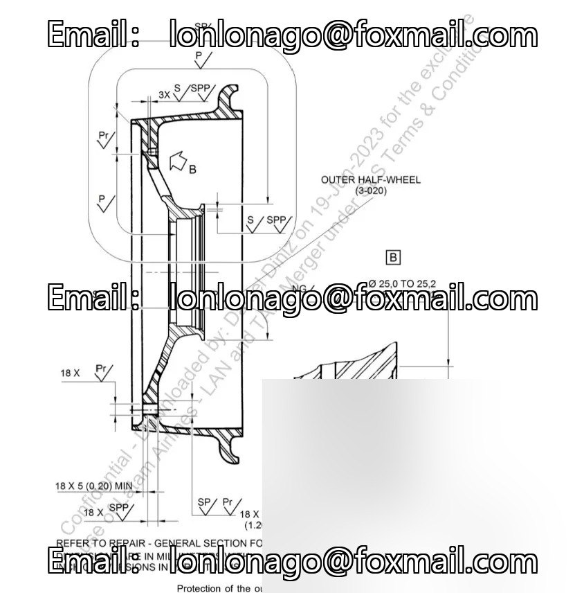
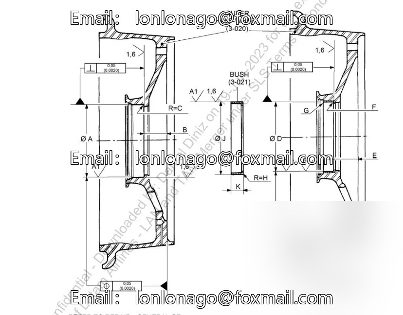
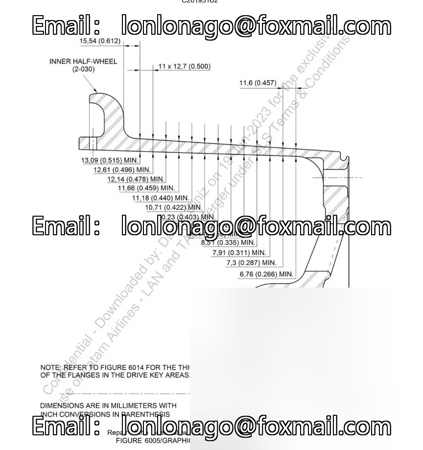
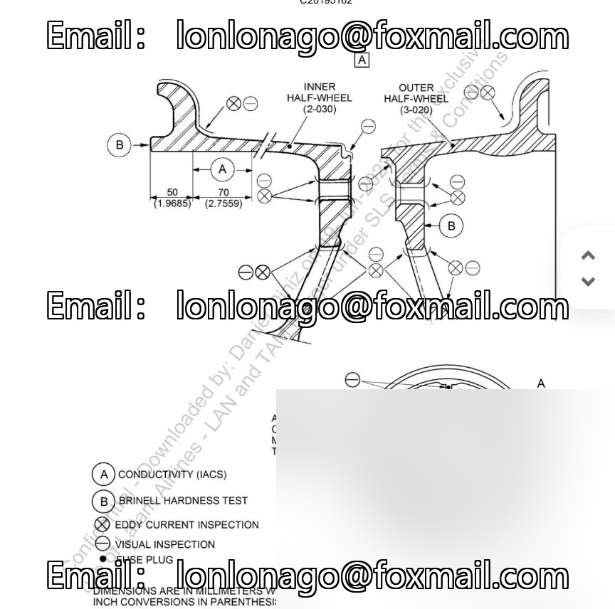
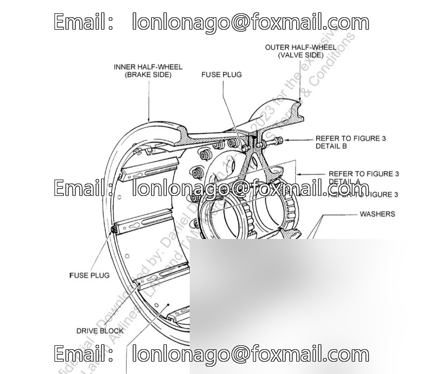

# Seiff Main Landing Gear Wheel Group Assembly

## Body

The PDF of the Maintenance Manual (Component Maintenance Manual, abbreviated as CMM) for SCF's main landing gear wheel assembly, 200 pages;
​The manual pertains to the core components of the aircraft's main landing gear. The main landing gear wheel assembly must withstand massive impact loads, high temperatures from brakes, and high-strength friction during landing. Therefore, the maintenance of this component has extremely strict timing standards (such as landing cycles) and process requirements.
713449752

The repair manual for the main landing gear wheel assembly covers maintenance for the aircraft's core wheel component, including repair specifications and related parameters.

<!-- AI_ENRICHED -->

## Images

## Payment

Here is a pay link on Stripe ( https://buy.stripe.com/3cs8yP7sY87d0vu9AB ). Please contact me lonlonago@foxmail.com after funding $89, and I will send you a complete data files , thank you!

